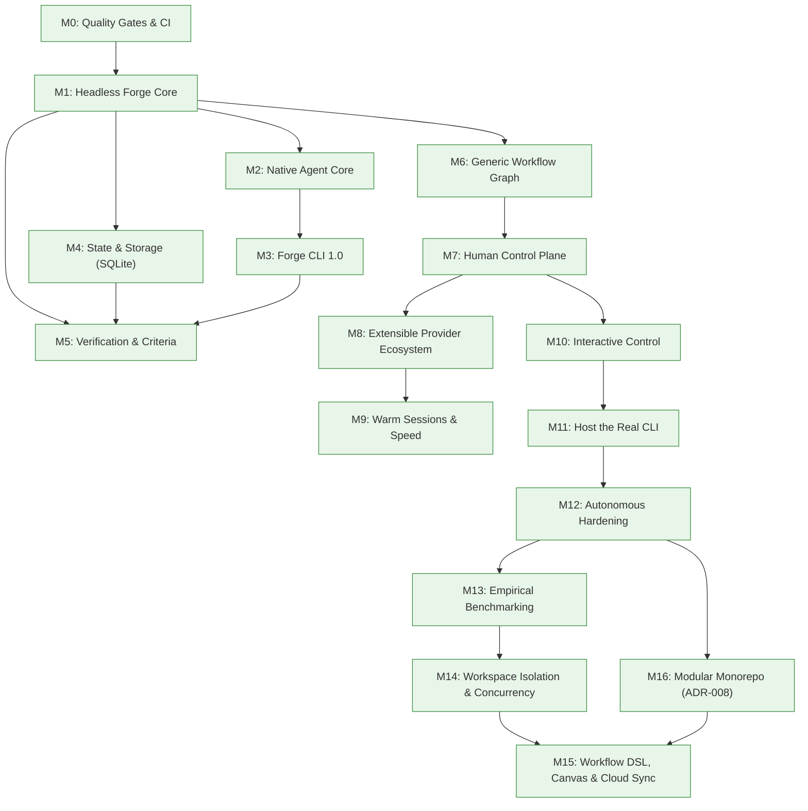

# Program Dependency Map

**Status:** IMPLEMENTED  
**Authority:** Planning Truth  
**Last Updated:** 2026-11-26  
**Baseline:** `main` @ `cfb0f4c` (PR #488 merged)  
**Related Milestones:** [milestones.md](milestones.md)  

---

## 1. Topological Milestone Dependencies

---

## 2. Key Blocking Paths

1. **Headless Decoupling (M1) Was the Universal Blocker**:
   - Decoupling `createForgeCore` from Electron (PR #198) enabled both the standalone CLI (`packages/forge-cli`) and automated headless CI testing across M2, M3, M4, and M6.
2. **Dual-Tier State (M4) Enabled Advanced Verification (M5)**:
   - SQLite `RunStore` and filesystem `ArtifactService` (PR #203) enabled independent verification (`CRIT-001`, `ARTIFACT-001`, `VERIFY-003`).
3. **Graph Engine (M6) Preceded Interactive Control & Real CLI Hosting (M7–M11)**:
   - Stage-level controls (`WORK-002`), blocking approval gates (`HUMAN-001`), and bidirectional ConPTY terminal sessions enabled real CLI orchestration without fragile stdout scraping.
4. **Monorepo Package Extraction (M16) Enforced Zero-Cycle Boundaries**:
   - Eliminating circular dependencies (`npm run check:cycles`) unlocked clean package separation into `@forge/shared`, `@forge/core`, `@forge/runtimes`, `@forge/cli`, and `@forge/desktop` prior to M13–M15 completion.
